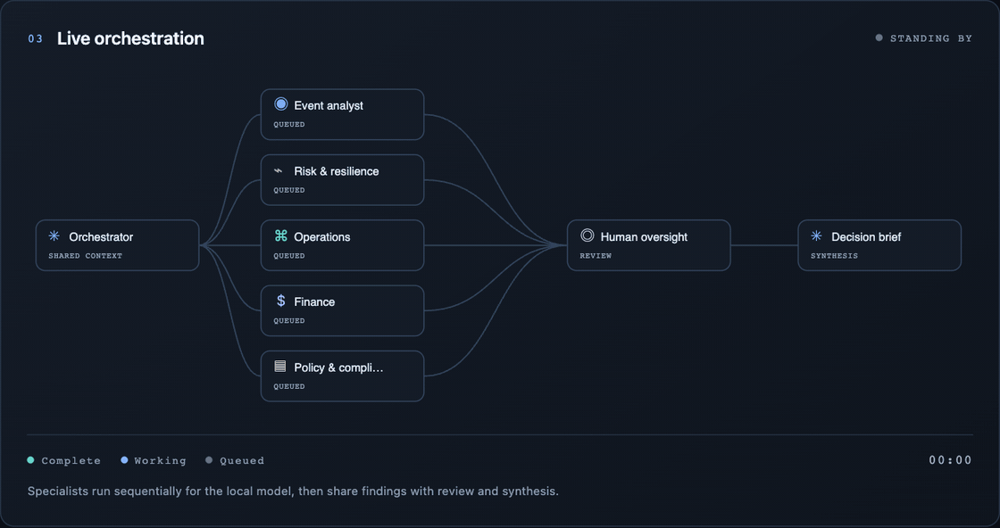
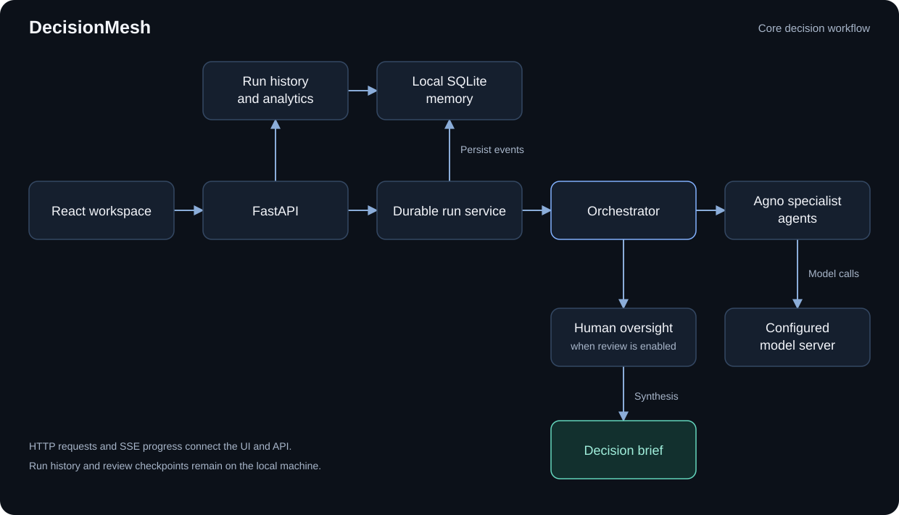

<div align="center">

# DecisionMesh

**Multi-agent decision intelligence, running locally.**

Seven specialist agents. One coordinated decision. A lasting record of every run.



*The actual React visualization, recorded with an illustrative seven-agent event replay.*

[Quick start](#quick-start) · [Features](#features) · [Architecture](#architecture) · [Local memory](#local-memory-and-analytics) · [Documentation](#documentation)

</div>

DecisionMesh is a local decision intelligence workbench inspired by the [reference paper](docs/Multi-agent_orchestration_architectures_for_real-t.pdf). Describe an enterprise event, select your agents, and watch their assessments flow into human oversight and a final decision brief. The stack combines **Python, Agno, FastAPI, React, TypeScript, and SQLite**, with a configurable **OpenAI-compatible model server**, including **Ollama on Windows, macOS, or Linux**.

## Features

| Capability | What you get |
| --- | --- |
| Live orchestration | Animated agent graph, execution timeline, individual findings, elapsed time, and cancellation |
| Seven starter roles | Event analysis, risk, operations, finance, compliance, human oversight, and decision synthesis |
| Custom specialists | Create, edit, select, and remove specialist agents; role definitions persist locally |
| Local model integration | Discover available models, select a model, and check the connection to your configured model server |
| Persistent run history | Search, filter, and revisit saved scenarios, findings, role snapshots, events, and outcomes |
| Agent analytics | Compare attempts, success rates, failures, average response times, and P95 latency |
| Human review | Pause for operator suggestions; finalize from saved findings or rerun as a linked revision |
| Enterprise events | Ingest normalized observations with deduplication, freshness checks, state versioning, and automatic decision creation |
| Agent negotiation | Validate evidence-linked proposals, exchange peer findings, resolve service/cost conflicts, and retain arbitration reasons |
| Inventory digital twin | Compare normal production, overtime, backup supply, and deferral using calculated outcomes |
| Governed local actions | Approve a specific simulated action, execute idempotently, and inspect acknowledgments and outcome reassessment |
| Research evaluation | Compare centralized and orchestrated Agno decisions on six fixed tasks; retain quality scores, latency, traces, and JSON exports |

DecisionMesh generates recommendations and can apply explicitly approved actions to its **local inventory simulator**. Review choices, overrides, and outcome feedback are saved. Real enterprise transactions and authenticated organizational approval ownership remain outside this local implementation.

## Quick start

### Requirements

- Python **3.12** and **Poetry 2.x**
- Node.js **22.12+** and npm
- An OpenAI-compatible model server, such as **[Ollama](https://ollama.com/download)**

**1. Start a model server and configure the endpoint**

Install and open Ollama. Its Windows application runs the API in the background; for a CLI installation, run `ollama serve` if a server is not already running. Download a chat model in another terminal:

```bash
ollama pull llama3.2
```

For a fresh checkout, create a root `.env` from the example:

```bash
# macOS / Linux
cp .env.example .env
```

```powershell
# Windows PowerShell
Copy-Item .env.example .env
```

The example uses Ollama's OpenAI-compatible endpoint:

```dotenv
LLM_BASE_URL=http://127.0.0.1:11434/v1
LLM_API_KEY=local
LLM_MODEL=
```

Leave `LLM_MODEL` empty to discover installed models, or use the exact model ID returned by `/v1/models` (for example, `llama3.2:latest`). Ollama ignores the placeholder API key. For another compatible server, set its API base URL, credential, and model ID using the same variables. See the [Ollama API guide](https://docs.ollama.com/api/openai-compatibility) and [Windows setup](https://docs.ollama.com/windows).

Run the backend and frontend from separate terminals:

**2. Python backend**

```bash
poetry install
poetry run uvicorn backend.app.main:app --reload --host 127.0.0.1 --port 8000
```

**3. React frontend**

```bash
cd frontend
npm install
npm run dev
```

Open **[DecisionMesh](http://127.0.0.1:5173)**. Vite proxies `/api` to FastAPI on port 8000. Interactive API documentation is available at **[API docs](http://127.0.0.1:8000/docs)**.

### Your first decision

1. Choose a local model in the workspace header.
2. Describe an event or choose one of six editable scenarios: supplier outage, demand surge, service disruption, budget pressure, data exposure, or warehouse bottleneck.
3. Select specialists and set the human-review preference.
4. Run the workflow and follow the graph, findings, and execution log. When human review is enabled, a dialog pauses the workflow before synthesis. Add suggestions and choose **Generate final brief** or **Revise & rerun agents**.
5. Open **Run History** to revisit the saved run, or **Analytics** to compare agent performance.

Navigating between pages keeps an active workflow running. Stop cancels the stream and in-flight generation while preserving completed findings. **Review later** keeps a checkpoint saved; continue it from Run History, even after a reload. A rerun creates a linked child so previous findings remain intact.

### Enterprise lab and research

1. Open **Enterprise lab** and create an inventory twin using the supplied defaults.
2. Send a disruption, demand surge, inventory observation, or external event JSON. Each accepted event versions the state and creates a decision.
3. Run Agno negotiation with two to seven specialists. Inspect competing proposals, peer revisions, arbitration, and evidence.
4. Compare simulated outcomes, enter a reviewer name and rationale, approve one feasible action, and execute it locally. State changes invalidate old approvals; repeated execution requests return the original receipt.
5. Follow the outcome reassessment or open its evidence in the existing decision workspace for an executive brief.
6. Open **Research** to run a live-model comparison across six fixed scenarios. Results include simulation-based decision quality, policy compliance, machine time, call counts, conflicts, and exportable traces. These jobs can take several minutes and are cancellable.

External producers can POST `/api/enterprise/events` independently of the UI. A portable producer is included at `scripts/ingest_event.py`. The [Enterprise loop guide](docs/EnterpriseLoop.md) documents the event contract, model assumptions, approval boundary, APIs, and evaluation rubric. The included feed and action adapter are simulations; no ERP service is connected.

## Architecture




Specialists run sequentially to respect local model capacity. With human review enabled, synthesis waits for an explicit operator choice and incorporates submitted suggestions. They share a scenario; oversight reviews their findings; synthesis receives the findings, oversight assessment, and missing perspectives. A failed specialist marks the result as partial. A failed synthesis cannot report workflow success.

Model requests use Agno's OpenAI-compatible adapter. DecisionMesh preserves the `system` instruction role and explicitly requests `stream: false` to support compatible servers with different message-role and streaming defaults. Live workflow updates to the browser use a separate Server-Sent Events stream with heartbeat comments.

### Repository layout

```text
backend/
  app/
    main.py                Application assembly and lifespan
    api/                   Thin HTTP routes and dependency injection
    core/                  Environment settings and application errors
    schemas/               Pydantic boundary contracts
    agents/                Starter roles, catalog, and Agno runner
    orchestration/         Coordinator and versioned run events
    services/              Model discovery, durable runs, and analytics
    storage/               SQLite schema, repositories, and data migration
    actions/               Local simulated action adapter behind approval checks
  tests/                   API, workflow, persistence, and analytics checks
frontend/
  src/
    components/            Reusable workspace, history, and analytics UI
    hooks/                 Run lifecycle, memory queries, and navigation
    pages/                 Workspace, Run History, and Analytics
    services/              Typed HTTP client, SSE parser, and formatting
    styles/                Design tokens and responsive layouts
    types.ts               Shared frontend contracts
  tests/                   Stream and display-format checks
  index.html               React entry document
  vite.config.ts           Development server and API proxy
docs/
  assets/                  README animation and documentation media
  *.md                     Product and engineering documents
data/                      Local runtime memory; excluded from Git
scripts/                   Portable external observation producer
pyproject.toml             Poetry project and dependency declarations
poetry.lock                Locked Python dependencies
```

## Local memory and analytics

DecisionMesh automatically creates **`data/decisionmesh.sqlite3`**. Every accepted workflow retains its scenario, model, original agent definitions, findings, timings, event timeline, and outcome. Custom agent changes persist across restarts. Failed model discovery is saved; cancellations retain partial findings; startup recovery marks abandoned active work as interrupted. Pending human-review checkpoints stay resumable across restarts; review decisions and linked revisions are retained.

Existing installations using the previous default database are imported through SQLite backup on first use of the new default. The original remains available, existing records in the new database are never replaced, and explicit `MEMORY_DB_PATH` settings are respected. Runs from before persistent recording cannot be reconstructed automatically.

| Page | Purpose |
| --- | --- |
| **[Workspace](http://127.0.0.1:5173/#/)** | Compose scenarios and watch active workflows |
| **[Run History](http://127.0.0.1:5173/#/history)** | Search/filter saved runs and inspect their findings, instructions, and event logs |
| **[Analytics](http://127.0.0.1:5173/#/analytics)** | View 7/30/90-day or all-time metrics, daily activity, and individual agent breakdowns |
| **[Enterprise lab](http://127.0.0.1:5173/#/enterprise)** | Ingest events, negotiate decisions, compare the twin, and approve local simulated actions |
| **[Research](http://127.0.0.1:5173/#/research)** | Run and inspect controlled model benchmarks and export experiments |

Agent success rate is **completed ÷ (completed + failed)** attempts. Average and P95 timings use completed attempts; P95 uses nearest rank. Cancelled, interrupted, active, and skipped executions are excluded from the success-rate denominator. Workflow completion rate includes partial completions and excludes active, awaiting-review, and superseded revision runs from its denominator. Completed workflow duration includes time spent waiting for human review. Daily buckets use UTC; all-time totals accompany a last-90-day chart. These metrics describe execution reliability and latency.

The archive stays on this machine and is not automatically injected into future model prompts. To back it up consistently, stop the backend and copy the database file. Use one API process per database so restart recovery can identify abandoned jobs correctly.

Enterprise state, event receipts, decision cases, action approvals/acknowledgments, and research jobs share the local database in separate tables (schema version 3). Pending review remains resumable; research jobs keep their partial progress and are marked interrupted after an ungraceful restart. Workspace analytics and research benchmarks use separate populations and denominators.

## Configuration

The backend loads the root `.env` file when present. Exported environment variables take precedence. See [`.env.example`](.env.example). Restart the backend after changing connection settings. The backend uses the OpenAI-compatible `/models` and `/chat/completions` routes relative to `LLM_BASE_URL`; include the `/v1` prefix when your server requires it.

| Variable | Default | Purpose |
| --- | --- | --- |
| `LLM_BASE_URL` | `http://127.0.0.1:11434/v1` | OpenAI-compatible model endpoint |
| `LLM_API_KEY` | `local` | Provider credential; placeholder for unauthenticated local servers |
| `LLM_MODEL` | First available model | Exact model ID from the configured server |
| `AGENT_TIMEOUT_SECONDS` | `180` | Per-agent generation timeout |
| `FRONTEND_ORIGIN` | `http://127.0.0.1:5173` | Allowed browser origin |
| `MEMORY_DB_PATH` | `data/decisionmesh.sqlite3` under the project root | Local memory file |

## Development and checks

From the repository root:

```bash
poetry run python -m unittest discover -s backend/tests -v
poetry check --lock
```

From `frontend/`:

```bash
npm test
npm run build
npm run preview
```

With the API, Vite UI, and model server running, `npm --prefix frontend run test:live` from the repository root runs the Playwright checks against the live UI. It uses installed Chrome, creates labeled QA records, and makes real model calls. See [Testing](docs/Testing.md) for setup, output locations, measured results, and verification limits.

## Documentation

[Product requirements](docs/PRD.md) · [Architecture](docs/Architecture.md) · [Research paper alignment](docs/PaperAlignment.md) · [Enterprise loop](docs/EnterpriseLoop.md) · [Testing](docs/Testing.md) · [Design](docs/Design.md) · [Project rules](docs/Rules.md) · [Project memory](docs/Memory.md)
