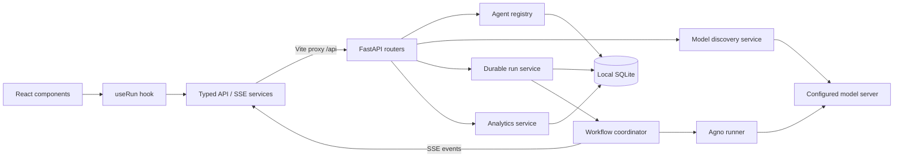

# DecisionMesh — Architecture

## Scope and stack

This local MVP implements the paper's specialist-agent, shared-context, orchestration, and governance themes. It is an advisory decision workflow; enterprise action execution, digital twins, arbitration protocols, and tamper-resistant auditing remain future work.

- **Backend:** Python 3.12, FastAPI, Pydantic, Agno, async HTTPX, python-dotenv. Dependencies managed with Poetry and `poetry.lock`.
- **Frontend:** React 19, TypeScript, Vite, CSS, browser Fetch/Streams APIs.
- **Models:** Agno `OpenAIChat` calls the configured OpenAI-compatible server through `LLM_BASE_URL`, `LLM_API_KEY`, and `LLM_MODEL`. The example/default endpoint is `http://127.0.0.1:11434/v1` for Ollama; other compatible servers use the same configuration.
- **Local storage:** standard-library SQLite with WAL, explicit transactions, one-time catalog seeding, and schema versioning.
- **Live updates:** versioned Server-Sent Events over a POST request, consumed with Fetch.

## Components

## Backend responsibilities

| Path | Responsibility |
| --- | --- |
| `backend/app/main.py` | Composition root: app creation, lifespan, CORS, error handler, router registration |
| `core/config.py` | Environment loading and immutable settings |
| `core/errors.py` | Transport-independent application errors |
| `schemas/` | Agent, run, and health boundary contracts |
| `agents/defaults.json` | Seven starter agent definitions |
| `agents/registry.py` | Catalog CRUD, stable IDs, core-role protection, selection validation |
| `agents/factory.py` | Agno construction, local model adapter, concurrency limit, timeout |
| `services/models.py` | Async discovery, model ID validation, connection health |
| `services/runs.py` | Persisted run lifecycle, including cancellation and setup failures |
| `services/analytics.py` | Aggregate, daily, and per-agent execution metrics |
| `storage/` | SQLite schema, catalog persistence, run/event transactions and queries |
| `orchestration/coordinator.py` | Specialist, oversight, synthesis lifecycle and shared findings |
| `orchestration/events.py` | Version 1 SSE envelope and serialization |
| `api/` | Request validation, service injection, HTTP responses and stream heartbeats |

Services belong to application lifespan state rather than mutable module-level registries. The registry returns copies so a run operates on a snapshot. Agno uses asynchronous calls; cancellation propagates to the in-flight request. Generation is limited to one call at a time across runs to suit a local model server. The service supports a single local workspace backed by SQLite. Catalog caching is per application; the database is authoritative across restarts.

The Agno factory overrides OpenAIChat's default `system` → `developer` role mapping to preserve `system` on the wire. Some compatible servers reject `developer` or default to SSE when `stream` is absent, so the factory explicitly sets `request_params={"stream": False}` for the non-streaming Agno execution path. This model response mode is independent of the API's workflow SSE stream.

## Frontend responsibilities

`src/main.tsx` mounts React. `App.tsx` switches between Workspace, History, and Analytics using hash routes. The workspace remains mounted during navigation so it can finish its stream. That page coordinates catalog/configuration state; presentational components render controls and results. `useRun` owns run state, event accumulation, elapsed time, cancellation, and terminal-stream validation. API requests and chunk-safe SSE parsing live in `src/services/`. Shared TypeScript contracts live in `types.ts`; design tokens and responsive styling live in `styles/global.css`. `frontend/public/` contains assets only.

## API and event contracts

| Method / path | Purpose |
| --- | --- |
| `GET /api/health` | Model endpoint, availability, catalog, default model, Agno availability |
| `GET /api/agents` | Current role definitions |
| `POST /api/agents` | Create a specialist |
| `PUT /api/agents/{id}` | Update a specialist without changing its ID |
| `DELETE /api/agents/{id}` | Remove a specialist; core roles are protected |
| `POST /api/run` | Validate scenario/team, persist submission, resolve model, and stream workflow events |
| `GET /api/runs` | Paginated run summaries; search by scenario/ID and filter by outcome |
| `GET /api/runs/{id}` | Saved scenario, immutable team snapshot, execution results, and event timeline |
| `GET /api/analytics?days=30` | Aggregate and per-agent metrics for 7/30/90 days or all time (`days=0`) |

Each SSE data envelope has `version`, `sequence`, `run_id`, `timestamp`, and `type`. Event types are `start`, `agent_start`, `agent_done`, `agent_error`, `complete`, and `error`. Agent events use `agent_id` and `name`; results include content/duration. Completion includes total duration, operator approval requirement, and whether results are partial. A heartbeat comment is sent every 10 seconds while awaiting model output. Reconnection/replay is not implemented.

## Workflow

1. Validate input/team and persist the scenario, review preference, and selected agent snapshot before model discovery. Setup failures are retained as failed runs.
2. Resolve the model and emit run start. Store each event and its execution state in one transaction before publishing it to the browser.
3. Run specialists sequentially against the shared scenario. Publish each result or failure immediately.
4. When enabled, run human oversight against specialist findings. Store its assessment with those findings.
5. Run synthesis against the findings, oversight output, missing perspectives, and review requirement. Bound accumulated context and label truncation.
6. Emit success (possibly partial) only after synthesis succeeds. If all specialists fail or synthesis fails, emit an error terminal state.

## Development and boundaries

Vite runs on `127.0.0.1:5173` and proxies `/api` to FastAPI at `127.0.0.1:8000`. Backend dependencies use Poetry; frontend dependencies use npm. Environment settings load from root `.env`, with shell values taking precedence. API responses do not expose credentials; Agno telemetry is disabled. UI and service errors avoid dumping scenarios or credentials.

The database contains `agents`, `runs`, `run_events`, `agent_executions`, and initialization metadata. Cancelled work is retained; never-started agents are skipped. On restart, abandoned running workflows become interrupted with unknown total duration rather than counting downtime as generation time. Use one API process per database so startup recovery cannot interrupt another process's live work. Catalog initialization occurs once; removing a starter specialist is respected after restarts. Historical records preserve deleted roles and the instructions that were used.

Analytics derive only from persisted attempts. Agent success rate excludes cancelled, interrupted, active, and skipped executions; average/P95 durations use successful completions. Daily buckets use UTC. Period totals are computed independently of the last-90-day chart limit for all-time queries. The history feature provides local execution memory, not automatic cross-run retrieval into agent prompts or an immutable compliance ledger.

Future work includes real approval records, digital-twin state, arbitration/negotiation, external connectors, and comparative benchmarks. No external enterprise actions are performed.

## Brand migration and documentation capture

The default database filename is `decisionmesh.sqlite3`. A missing new default is initialized from the prior default through SQLite backup, which includes committed WAL data and preserves the original file. An existing new database is never reimported, and explicit custom database paths are respected.

Model health responses expose `llm_url` and `llm_online`. UI connection checks and error messages are provider-neutral. Ollama uses its OpenAI-compatible routes, not its native `/api/chat` interface. Connection settings come from generic configuration rather than platform-specific branching.
